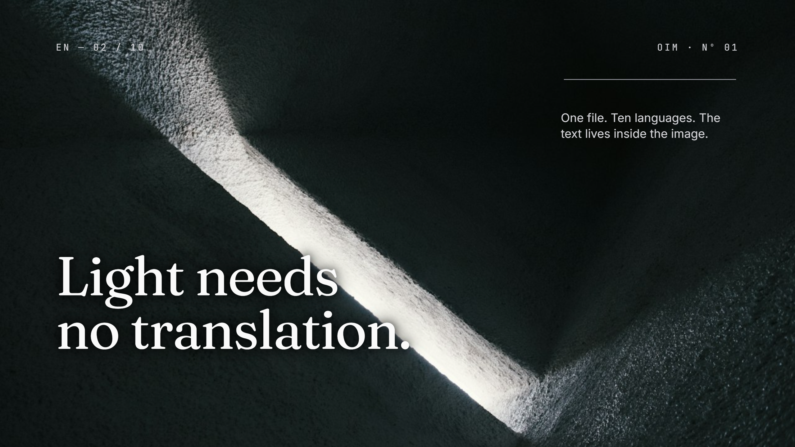

# OIM Media

OIM (Object Interactive Media) is an open specification and format ecosystem for decoupled, interactive, and multilingual visual media.

Traditional digital graphics flatten text, branding, and layouts directly into fixed raster pixels. This creates duplicate exports for each target language, destroys accessibility, prevents search indexing, and demands full re-rendering whenever copy or styles change.

OIM solves this by separating base visual assets from dynamic vector and typographic content. An `.oim` file encapsulates both within a standard image container (such as PNG). Devices without OIM support display the raster image naturally, while OIM-compliant engines mount and animate reactive, accessible, and localized layers directly over the canvas.

<p align="center">
  <a href="https://oim.media" target="_blank" rel="noopener noreferrer">
    
  </a>
</p>

---

## Architectural Principles

### Universal Fallback
An `.oim` file is a valid standard PNG image. Any browser, image viewer, operating system preview, or social media crawler renders the base raster asset without requiring extensions, polyfills, or custom software.

### Decoupled Content Layer
Typography, call-to-action buttons, vector geometries, dynamic color roles, and interactive states are stored as structured metadata in a compressed `tEXt` chunk (`OIM_Data`) using raw Deflate compression. 

### Single-File Multilingual Distribution
All language translations coexist within a single file. Viewers switch languages instantaneously on the client side without issuing additional network requests or requiring separate localized media files.

### Cryptographic Provenance and Integrity
Files can be cryptographically signed using ECDSA signatures over canonical representations (RFC 8785) and SHA-256 digests. Readers verify authenticity offline against embedded public keys, guaranteeing that layers, text, and visual assets have not been altered or tampered with.

### Zero Phone-Home Security Model
The reference web components operate strictly offline in a sandbox environment. Signature verification, font decompression, and layer rasterization do not perform telemetry, tracking, or unsolicited external network calls.

### Native Accessibility and Search Indexing
Interactive layers are projected into a dedicated accessibility tree (`.oim-a11y`) containing semantic HTML elements (`h1`-`h6`, `p`, `button`, `a`). Screen readers and search engine crawlers can read, index, and navigate content natively.

---

## Core Specification and Packages

The open standard, reference implementations, and test suites are developed in the [`oim-media/oim`](https://github.com/oim-media/oim) repository.

| Package | Registry Scope | Description |
|---|---|---|
| `@oim-media/core` | npm / GitHub Packages | Normative contract schema (Zod), binary reader/writer, canonical RFC 8785 serialization, and mathematical projection logic. |
| `@oim-media/player-oim` | npm / GitHub Packages | Lightweight custom element (`<oim-player>`) providing hardware-accelerated rendering and sandbox validation. |
| `@oim-media/player-ovm` | npm / GitHub Packages | Standalone player for OVM (Object Video Media) interactive video experiences with temporal keyframing. |
| `@oim-media/spec` | npm / GitHub Packages | Language-neutral specification: JSON Schema, binary specification, authorized public keys, and 101 canonical conformance vectors. |

---

## Quick Start

### Web Component Integration

Install the web player package:

```bash
pnpm add @oim-media/player-oim
```

Embed an interactive image directly into your markup:

```html
<script type="module" src="node_modules/@oim-media/player-oim/dist/esm/index.js"></script>

<oim-player
  src="asset.oim.png"
  lang="en"
  fit="contain"
  activate-on="visible">
</oim-player>
```

### Programmatic API Usage

```javascript
import { OimPlayer } from "@oim-media/player-oim";

const container = document.getElementById("player-container");
const player = OimPlayer.mount(container, "asset.oim.png", {
  allowZoom: true,
  showLanguageSelector: true
});

// Programmatic control
player.setLang("es");
player.play();
```

---

## Conformance and Standards Governance

The OIM specification is versioned strictly using Semantic Versioning:

- **Major**: Breaking changes in rendering semantics or binary layout where an existing `.oim` file would render differently.
- **Minor**: Non-breaking additions of new layer types, attributes, or capabilities. Existing readers safely ignore unrecognized attributes.
- **Patch**: Internal fixes, performance optimizations, or visual corrections without format modifications.

Every implementation must pass the 101 canonical conformance test vectors distributed in `@oim-media/spec` before claiming standard compliance.

---

## Ecosystem Resources

- Official Website: [oim.media](https://oim.media)
- Interactive Editor (OIM Studio): [studio.oim.media](https://studio.oim.media)
- Documentation: [docs.oim.media](https://docs.oim.media)
- Community Discord: [discord.gg/FmawxUnF](https://discord.com/invite/FmawxUnF)
- Security Contact: devs@oim.media

---

## License

The OIM open specification, core packages, and reference players are licensed under the [Apache License 2.0](https://www.apache.org/licenses/LICENSE-2.0).
